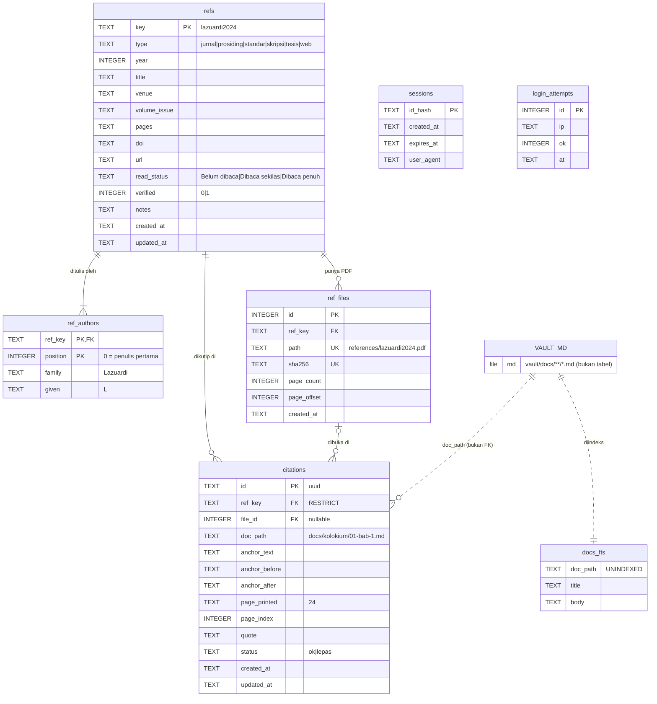

# ERD nyoba

SQLite cuma pegang hal yang nggak cocok ditaruh di markdown. Isi naskah **nggak pernah** masuk sini.

SQL lengkapnya: [`src/lib/server/db/schema.sql`](../src/lib/server/db/schema.sql).

> `VAULT_MD` itu bukan tabel, cuma penanda bahwa `citations.doc_path` dan `docs_fts` nunjuk ke file di vault.

## Per tabel

### `refs` — satu baris = satu sumber

- `key` dibikin dari aturan kunci (nama belakang + tahun). `CHECK` kasar memastikan bentuknya huruf kecil + 4 digit tahun.
- Kunci boleh diganti **cuma kalau** belum ada sitasi (dicek di app). `ON UPDATE CASCADE` di tabel anak cuma jaring pengaman.
- Tiap perubahan di sini → ekspor ulang `vault/references.json` → ikut ke-commit. Jadi `refs` + `ref_authors` bisa dipulihkan dari Git.

### `ref_authors` — penulis berurutan

- Dipisah biar CSL-JSON (`author: [{family, given}]`) & BibTeX gampang dibikin.
- Lembaga (`OWASP Foundation`) → taruh di `family`, `given` kosong.

### `ref_files` — PDF milik referensi

- Biasanya satu PDF per referensi (`references/<kunci>.pdf`), tapi desainnya 1:N buat jaga-jaga (misal lampiran).
- `sha256 UNIQUE` → upload file yang sama dua kali ditolak.
- `page_offset` → kalau halaman tercetak 24 ada di halaman PDF 30, offset = 6. Dipakai buat ngisi otomatis.

### `citations` — jantungnya nyoba 💓

- Satu baris = **satu pemakaian** referensi di naskah. Referensi yang sama dikutip 5× = 5 baris, tiap baris punya halaman PDF sendiri.
- `doc_path` sengaja **bukan FK** — dokumen hidupnya di file, bukan di DB. Kalau tab di-rename lewat app, app wajib `UPDATE citations SET doc_path = ...`.
- `ref_key ON DELETE RESTRICT` → referensi yang masih dikutip nggak bisa dihapus.
- `status = 'lepas'` → teks yang diblok udah nggak ketemu. Muncul di panel peringatan.
- "Dipakai di subbab" = `SELECT DISTINCT doc_path FROM citations WHERE ref_key = ? AND status = 'ok'`.

### `sessions` & `login_attempts` — urusan pintu

- Cookie nyimpen token acak; DB cuma nyimpen hash-nya. DB bocor ≠ sesi bocor.
- Rate limit: misal maks 5 gagal / 15 menit / IP. Baris lama dibersihin berkala.

### `docs_fts` — indeks cari

- Cache murni. Hapus & bangun ulang dari vault kapan aja tanpa kehilangan apa pun.

## Apa yang bisa hilang kalau `app.db` meledak? 💥

| Data                   | Bisa dipulihkan?                                |
| ---------------------- | ----------------------------------------------- |
| Naskah                 | ✅ nggak pernah di DB                           |
| Referensi + penulis    | ✅ dari `references.json` di Git                |
| File PDF               | ✅ ada di vault; `ref_files` bisa di-scan ulang |
| Indeks cari            | ✅ bangun ulang                                 |
| Sesi & percobaan login | 🤷 login ulang aja                              |
| **Posisi sitasi**      | ⚠️ cuma dari `data/backups/` harian             |

Pelajaran: backup harian `app.db` itu **wajib**, bukan opsional. (v2: pertimbangkan ekspor `citations` ke `vault/.nyoba/citations.json` biar ikut Git juga.)
