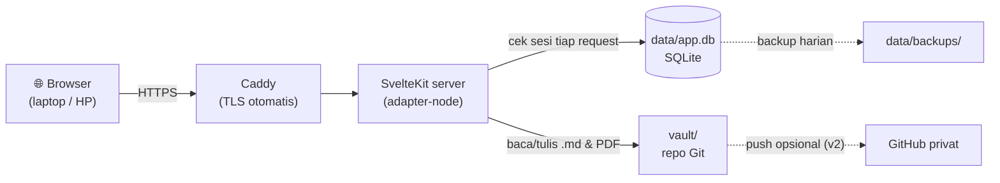

# Spek nyoba (versi kurasi)

Ini versi yang dipegang. Spek mentahnya ada di [`spek-asli.md`](spek-asli.md); bagian [Apa yang diubah dari spek asli](#apa-yang-diubah-dari-spek-asli) di bawah ngejelasin bedanya.

## TL;DR

Editor markdown berbasis web, **satu pengguna**, buat nulis draf skripsi. Isi naskah = file `.md` di repo Git. Metadata (referensi, posisi sitasi, indeks cari) = satu file SQLite. Sitasi pakai sintaks Pandoc dan bisa diklik buat buka PDF di halaman yang pas.

## Enam aturan main

1. **Satu server, satu orang.** Deploy ke VPS dengan disk persisten, buka dari browser mana aja. Login pakai username + hash password dari env.
2. **Markdown adalah sumber kebenaran.** Teks naskah cuma ada di `vault/` (repo Git). Kalau aplikasinya hilang, naskahnya masih utuh & kebaca di Obsidian.
3. **SQLite cuma buat yang nggak muat di markdown:** referensi, posisi sitasi, sesi login, indeks cari. Semua yang di SQLite bisa dibangun ulang dari vault, kecuali posisi sitasi (makanya ada backup harian).
4. **Sitasi = Pandoc** `[@kunci, hlm. 24]`, diformat pakai CSL lewat citeproc-js pas ekspor.
5. **Nulis dulu, cantik belakangan.** Format naskah urusan CSL + ekspor, bukan editor.
6. **Bukan Google Docs.** Nggak ada kolaborasi, komentar, diagram interaktif.

## Arsitektur



Semua request (halaman & API) lewat `hooks.server.ts` yang ngecek sesi. Tanpa sesi: halaman → redirect ke `/login`, API → `401`.

## Fitur & prioritas

Legenda: 🟢 mudah · 🟡 sedang · 🔴 sulit

### MVP (wajib buat bisa dipakai skripsian)

| Fitur                              | Susah? | Catatan                                                                          |
| ---------------------------------- | ------ | -------------------------------------------------------------------------------- |
| Login satu pengguna                | 🟢     | argon2id, cookie `httpOnly; Secure; SameSite=Lax`, rate limit login, wajib HTTPS |
| Dokumen bertab                     | 🟢     | dokumen = folder, tab = file `.md`, urutan tab di `_doc.md`                      |
| Editor Tiptap                      | 🟡     | judul, list, task, tabel, tebal/miring. **Wajib lulus tes round-trip**           |
| Dropdown di sel tabel              | 🟡     | opsi per kolom di frontmatter; sel tetap teks biasa                              |
| Wikilink `[[...]]`                 | 🟢     | antar-tab & antar-dokumen                                                        |
| Riwayat versi                      | 🟢     | commit Git otomatis (lihat [Aturan commit](#aturan-commit))                      |
| Pustaka referensi                  | 🟢     | tabel di SQLite, diekspor ke `references.json`                                   |
| Upload PDF                         | 🟢     | disimpan `references/<kunci>.pdf`, dicek sha256 biar nggak dobel                 |
| Tambah sitasi dari blok teks       | 🟡     | klik kanan → _Tambah referensi_                                                  |
| Klik sitasi → PDF di halaman tepat | 🟢     | PDF.js                                                                           |
| "Dipakai di subbab" otomatis       | 🟢     | query dari tabel `citations`                                                     |
| Pencarian teks penuh               | 🟢     | FTS5                                                                             |
| Sinkron vault ke GitHub            | 🟢     | push tiap commit ke repo **privat**, tarik pas app nyala (`VAULT_REMOTE`)        |

### v2 (habis MVP kepake)

| Fitur                       | Susah? | Catatan                                                |
| --------------------------- | ------ | ------------------------------------------------------ |
| Sorot kalimat persis di PDF | 🔴     | best-effort via text layer; gagal di PDF scan          |
| Ekspor CSL-JSON & BibTeX    | 🟢     | buat Zotero / Word                                     |
| Salin untuk skripsi         | 🟢     | citeproc-js + CSL → `(Lazuardi 2024)` + daftar pustaka |
| Isi metadata dari DOI       | 🟢     | Crossref, tetap dicek manual                           |
| Chip tanggal                | 🟢     | disimpan ISO `2026-10-15`                              |

### Nanti / nggak dibuat

- **Nanti:** tandai area kotak di PDF (cadangan kalau sorotan teks gagal).
- **Nggak dibuat:** kolaborasi real-time, komentar, diagram, OCR.

## Struktur vault

```
vault/                       ← repo Git
  docs/
    tracker-skripsi/         ← satu dokumen
      _doc.md                ← judul dokumen + urutan tab
      01-progress.md         ← satu tab
      02-log-kerja.md
    kolokium/
      _doc.md
      01-bab-1.md
  references/
    lazuardi2024.pdf
  references.json            ← CSL-JSON, auto-ekspor dari SQLite
  styles/
    ipb.csl
data/                        ← DI LUAR vault, nggak masuk Git
  app.db
  backups/app-2026-10-15.db
```

Contoh `_doc.md`:

```markdown
---
title: Tracker Skripsi
tabs: [01-progress, 02-log-kerja]
---
```

## Konvensi markdown

**Dropdown** didefinisikan di frontmatter tab, per nama kolom:

```markdown
---
title: Progress
enums:
  Status: [Belum mulai, Riset, Draf, Revisi, Disetujui pembimbing]
---

| Subbab             | Status | Langkah berikutnya       |
| ------------------ | ------ | ------------------------ |
| 1.1 Latar Belakang | Draf   | Cari sumber primer OWASP |
```

Kalau isi sel nggak ada di daftar enum, chip tampil abu-abu + ikon ⚠️ (nggak dihapus, nggak diubah).

**Sitasi** ditaruh setelah teks yang dirujuk:

```markdown
Broken access control naik ke peringkat pertama OWASP Top 10 2021 [@owasp2021].
Endpoint penilaian rata-rata merespons dalam 9,6 detik [@muhammad2025, hlm. 39].
```

**Aturan:**

- **Kunci referensi** = nama belakang penulis pertama + tahun, huruf kecil, tanpa spasi/aksen. Bentrok? Tambah huruf: `annisa2024a`, `annisa2024b`. Kunci **nggak bisa diganti** setelah dipakai sitasi (biar nggak ada sitasi yatim).
- **Halaman di naskah** = nomor tercetak. Nomor halaman PDF cuma disimpan di SQLite buat navigasi.
- **Teks yang diblok** nggak ditandai di markdown. Posisinya disimpan di SQLite dan dicocokkan ulang tiap simpan.
- **Wikilink:** `[[01-progress]]` (dalam dokumen yang sama) atau `[[tracker-skripsi/01-progress]]`.

## Aturan commit

Autosave tiap beberapa detik + commit tiap simpan = ribuan commit sampah. Jadi:

- **Simpan ke disk:** debounce ~1 detik setelah berhenti ngetik.
- **Commit Git:** setelah 60 detik idle, pas pindah tab/dokumen, atau pas tutup halaman. Satu commit bisa berisi beberapa file.
- **Pesan commit:** `edit: kolokium/01-bab-1` atau `ref: tambah lazuardi2024`.
- **Penulis commit:** `nyoba <nyoba@localhost>`.

## Apa yang ikut ke GitHub

Prinsipnya: **semua yang penting ada di vault**, jadi cukup vault yang di-push.

| Data             | Di mana                                                     | Ikut push?                                                   |
| ---------------- | ----------------------------------------------------------- | ------------------------------------------------------------ |
| Naskah & tracker | `vault/docs/**/*.md`                                        | ✅                                                           |
| PDF referensi    | `vault/references/*.pdf` (M4)                               | ✅                                                           |
| Daftar referensi | `vault/references.json`, ekspor otomatis dari DB (M4)       | ✅                                                           |
| Posisi sitasi    | `vault/.nyoba/citations.json`, ekspor otomatis dari DB (M5) | ✅                                                           |
| `app.db`         | `.data/`                                                    | ❌ isinya sesi login + cache; bisa dibangun ulang dari vault |

`app.db` sengaja nggak di-push: file biner di Git bikin repo cepat bengkak dan gampang konflik.

## Model data

Lihat [`erd.md`](erd.md) buat ERD + penjelasan, dan [`schema.sql`](../src/lib/server/db/schema.sql) buat SQL-nya.

## Alur sitasi

**Nambah sitasi**

1. Blok teks di editor → klik kanan → **Tambah referensi**.
2. Cari referensi (kunci / penulis / judul) atau bikin baru + pilih PDF.
3. Panel PDF kebuka di kanan. Lompat ke halaman yang dimaksud, (opsional) blok kalimat sumbernya.
4. Isi halaman tercetak. Kalau PDF punya page label atau referensi punya `page_offset`, ini keisi otomatis.
5. Aplikasi nyisipin `[@kunci, hlm. X]` setelah teks yang diblok, lalu simpan baris baru di `citations`.

**Buka sitasi**

1. Hover chip sitasi → pratinjau (judul, penulis, kutipan sumber). Klik → panel PDF kebuka di halaman tersimpan.
2. Kalau ada `quote`, cari di text layer PDF dan sorot. Nggak ketemu? Halamannya tetap kebuka + catatan kecil "sorotan gagal".

**Cocok ulang (re-anchor)** — jalan tiap simpan:

1. Cari `anchor_text` di file. Ketemu satu → beres.
2. Ketemu banyak → pilih yang `anchor_before`/`anchor_after`-nya paling mirip.
3. Nggak ketemu → status jadi `lepas`, masuk panel peringatan buat ditempel ulang.
4. Marker `[@kunci...]` dihapus manual dari teks → baris sitasinya ikut `lepas`, bukan langsung dihapus.

## Tampilan

```
┌──────────┬──────────────────────────────┬───────────────┐
│ Sidebar  │          Editor              │  Panel kanan  │
│ ~240px   │       maks ~720px            │  (kalau perlu)│
│          │                              │               │
│ Dokumen  │  # Bab 1                     │  📄 PDF.js    │
│  └ tab   │  Lorem ipsum [Lazuardi 2024, │  hlm. 24      │
│ Referensi│  hlm. 24] dolor sit amet...  │               │
│ Cari     │                              │  ↔ resizable  │
└──────────┴──────────────────────────────┴───────────────┘
```

- Sidebar bisa disembunyiin. Toolbar cuma muncul pas teks diblok (bubble menu) + pintasan keyboard.
- Warna netral hangat, **satu** warna aksen buat tautan & sitasi. Mode terang & gelap.
- UI sans-serif, isi naskah boleh serif.
- Sitasi tampil sebagai chip "Lazuardi 2024, hlm. 24", bukan `[@...]` mentah.
- Chip dropdown: satu warna lembut per opsi (warnanya diturunkan dari urutan opsi biar konsisten).
- No shadow tebal, no gradien. Garis tipis aja.

## Env

| Variabel            | Isi                                          |
| ------------------- | -------------------------------------------- |
| `APP_USER`          | username login                               |
| `APP_PASSWORD_HASH` | hash argon2id (bukan password asli!)         |
| `SESSION_SECRET`    | string acak ≥ 32 karakter                    |
| `VAULT_PATH`        | path folder vault, default `./vault`         |
| `DATA_PATH`         | path folder data, default `./.data`          |
| `DOMAIN`            | (Docker) domain buat HTTPS otomatis di Caddy |

Env dibaca lewat `node --env-file` (bukan `$env` Vite), karena Vite ngerusak hash argon2: `$...` di `.env` dianggap variabel. adapter-node v6 udah nggak pakai `ORIGIN`; header proxy (`PROTOCOL_HEADER`, `HOST_HEADER`, `ADDRESS_HEADER`, `XFF_DEPTH`) udah dipasang di `Dockerfile`. Hash di `.env` wajib kutip tunggal karena Docker Compose juga ngembangin `$`.

## Pertanyaan terbuka

- [ ] VPS mana? Syarat: disk persisten, bisa Docker, ~2 GB buat PDF.
- [ ] Kirim file CSL-nya, cek apakah ada format sitasi dalam teks (Nama Tahun) + daftar pustaka.
- [ ] Format penulis di daftar pustaka IPB: "Lazuardi L" (inisial tanpa titik)? Ini nentuin cara isi `given` di `ref_authors`.

## Apa yang diubah dari spek asli

| Bagian                | Asli                             | Sekarang                                                        | Kenapa                                                                                                                      |
| --------------------- | -------------------------------- | --------------------------------------------------------------- | --------------------------------------------------------------------------------------------------------------------------- |
| Penulis referensi     | satu kolom teks `'Lazuardi L'`   | tabel `ref_authors` (family, given, urutan)                     | CSL & BibTeX butuh nama terstruktur. Parsing "Lazuardi L" balik ke family/given itu rawan, apalagi nama Indonesia satu kata |
| Commit Git            | tiap simpan                      | debounce idle 60 dtk / pindah tab                               | autosave bikin commit meledak, riwayat jadi nggak kebaca                                                                    |
| Konteks sitasi        | cuma `anchor_before`             | + `anchor_after`                                                | teks yang sama bisa muncul berkali-kali; dua sisi konteks bikin cocok ulang lebih akurat                                    |
| Hapus referensi       | `citations.ref_key` tanpa aturan | `ON DELETE RESTRICT`                                            | referensi yang masih dikutip nggak boleh hilang diam-diam                                                                   |
| Sesi login            | "cookie httpOnly"                | tabel `sessions` (token di-hash)                                | biar bisa logout beneran & kedaluwarsa di server                                                                            |
| Rate limit login      | disebut aja                      | tabel `login_attempts`                                          | tahan restart server                                                                                                        |
| Kolom enum di SQLite  | teks bebas                       | `CHECK (...)`                                                   | data ngaco ketahuan di DB, bukan pas ekspor                                                                                 |
| FTS5                  | `doc_path` diindeks              | `doc_path UNINDEXED`, tokenizer `unicode61 remove_diacritics 2` | nggak perlu cari di path; aksen diabaikan                                                                                   |
| `_doc.md`             | "metadata + urutan tab"          | format frontmatter didefinisikan                                | biar M1 nggak nebak                                                                                                         |
| Env                   | 3 variabel                       | + `VAULT_PATH`, `DATA_PATH`, header proxy                       | spek M0 nyebut path vault dari env; adapter-node v6 butuh header proxy di belakang Caddy                                    |
| Cell enum nggak valid | nggak dibahas                    | chip abu-abu + ⚠️                                               | jangan pernah ngubah isi file diam-diam                                                                                     |
| Ganti kunci referensi | nggak dibahas                    | dikunci setelah dipakai                                         | cegah sitasi yatim                                                                                                          |
